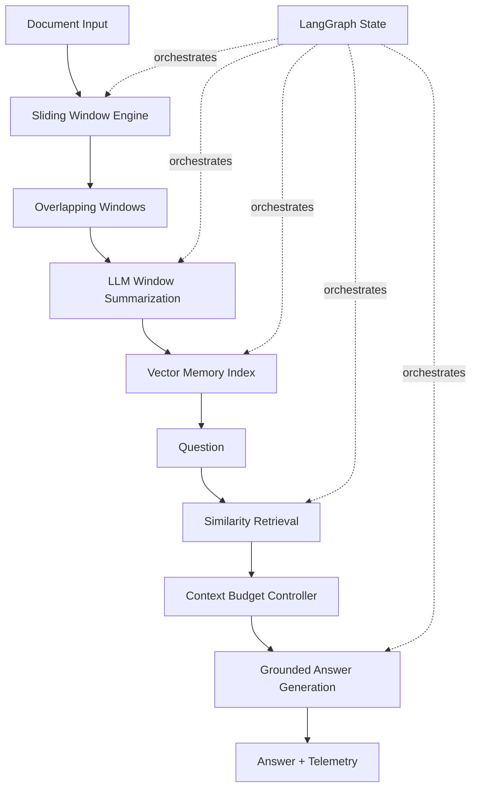

# WindowMind AI
### Intelligent Sliding Window Context Management & Research Agent

WindowMind is an advanced, local-first AI engineering project demonstrating how overlapping
sliding windows can support long-document analysis, context management, and retrieval-grounded
question answering. It combines Python, LangChain, LangGraph, and Ollama.

## Why this project matters

LLMs operate within finite context budgets. Passing an entire large document into every prompt
can be inefficient, expensive, and sometimes impossible. WindowMind splits source text into
overlapping windows, summarizes each window, indexes the windows in vector memory, retrieves
the most relevant passages for a question, and generates an answer grounded in those passages.

## Architecture



## Core concepts demonstrated

- **Window size:** maximum character length of a chunk.
- **Overlap:** shared characters between adjacent chunks.
- **Stride:** distance between window start positions (`window_size - overlap`).
- **Context budgeting:** limits how much retrieved text is sent to the model.
- **Semantic retrieval:** uses Ollama embeddings and an in-memory vector store.
- **Graph orchestration:** LangGraph coordinates each processing stage.
- **Grounded generation:** prompts the model to cite retrieved window identifiers.

> This implementation uses character-based windows for transparent, reproducible boundaries.
> Character counts are not token counts. A production tokenizer-aware implementation should use
> the tokenizer associated with the target model.

## Technology stack

| Technology | Responsibility |
|---|---|
| Python | Core logic and application |
| LangChain | Prompt composition, model and document abstractions |
| LangGraph | Explicit stateful workflow |
| Ollama | Local chat and embedding inference |
| Pydantic | Configuration and data validation |
| Pytest | Unit tests |
| Rich | Terminal presentation |
| psutil | Optional system telemetry extension |

## Requirements

- Python 3.11+ (the project is designed to run on Python 3.14 where dependencies support it)
- Ollama installed and running
- A chat model, e.g. `llama3.2:3b`
- An embedding model, e.g. `nomic-embed-text`

## Setup (Windows PowerShell)

```powershell
# 1. Create and activate a virtual environment
py -3.14 -m venv .venv
.\.venv\Scripts\Activate.ps1

# 2. Upgrade packaging tools and install the project
python -m pip install --upgrade pip
pip install -e .

# 3. Pull the required local models
ollama pull llama3.2:3b
ollama pull nomic-embed-text

# 4. Create your local configuration
Copy-Item .env.example .env

# 5. Confirm Ollama is responding
ollama list
```

If Python 3.14 exposes a dependency compatibility issue on your machine, use Python 3.12
for this project rather than changing application code to work around a package installation issue.

## Run

From the repository root:

```powershell
windowmind --file sample_data/research_brief.md --question "Why does sliding-window overlap improve retrieval quality, and what trade-offs does it introduce?"
```

Alternative:

```powershell
python -m windowmind.cli --file sample_data/research_brief.md --question "Explain the role of LangGraph in this system."
```

## Test

```powershell
pytest
```

The unit tests validate window creation, overlap behavior, empty-input handling, and configuration
constraints. They do not require Ollama because the core sliding-window algorithm is deterministic.

## Configuration

Edit `.env`:

| Variable | Default | Meaning |
|---|---:|---|
| `OLLAMA_BASE_URL` | `http://localhost:11434` | Ollama endpoint |
| `OLLAMA_CHAT_MODEL` | `llama3.2:3b` | Generation model |
| `OLLAMA_EMBED_MODEL` | `nomic-embed-text` | Embedding model |
| `WINDOW_SIZE` | `1200` | Characters per window |
| `WINDOW_OVERLAP` | `200` | Shared characters |
| `RETRIEVAL_K` | `4` | Number of retrieved windows |
| `MAX_CONTEXT_CHARS` | `9000` | Context cap sent to LLM |
| `TEMPERATURE` | `0.1` | Generation temperature |

## Engineering decisions and limitations

1. The vector store is in-memory and is rebuilt for each run. A next iteration can persist vectors
   in Chroma, FAISS, or a managed vector database.
2. Windows are character-based, not tokenizer-based. Token-aware splitting is a worthwhile
   extension for strict model context limits.
3. Window summaries are generated sequentially to keep local RAM and CPU usage predictable.
4. The current graph is a deterministic pipeline. Conditional retry, checkpointing, and human
   review can be added as production extensions.
5. The context cap is a character-level safety guard, not an exact model-token budget.
6. Embeddings require the separate `nomic-embed-text` Ollama model.

## Suggested roadmap

- [ ] Tokenizer-aware windowing and token budget enforcement
- [ ] Persistent vector database and document collections
- [ ] Conversation memory with recent-turn buffer + summary + retrieval
- [ ] LangGraph checkpointing and resumable workflows
- [ ] Retry policies and model health checks
- [ ] Evaluation dataset for retrieval precision and answer faithfulness
- [ ] FastAPI service and Docker deployment
- [ ] MLflow experiment tracking and latency dashboards

## Example interview explanation

"WindowMind demonstrates context engineering for LLM applications. I implemented overlapping
document windows to reduce boundary information loss, used LangChain to compose local model
prompts and embeddings, and used LangGraph to make ingestion, summarization, indexing, retrieval,
and answer generation explicit graph stages. The system measures window geometry and constrains
retrieved context before generation. The design separates deterministic text processing from
probabilistic LLM operations, which improves testability and observability."

## License

MIT
